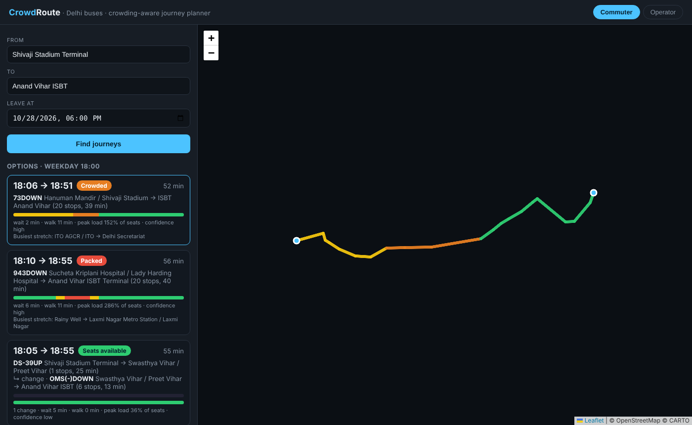

# CrowdRoute — crowdedness-aware bus journey planner for Delhi

**Transport Stack Hackathon 2026 · Problem 2 · Phase 1 submission**

CrowdRoute turns 2.56 million October 2026 e-ticket records into an estimate of how full every Delhi bus is on every stretch of its route at every half hour of the day — and puts that next to each option in a journey planner, so a commuter can choose between a faster trip and a more comfortable one. The same model powers an operator view that shows where and when buses are overloaded.



| | |
|---|---|
| **Input** | ONDC e-ticketing CSV (start stop, end stop, route, time, passengers) + Delhi static GTFS |
| **Output** | 2.9 M crowding cells: `route × stretch × day-type × 30-min band → on-board load, load factor, level, confidence` |
| **Planner** | Direct and one-transfer journeys on GTFS schedules, each stretch coloured by crowding, plus "leave 15/30/45 min later" alternatives |
| **Operator view** | City-wide heatmap with a time slider, most-overloaded stretches, network load curve |
| **Validation** | AM/PM peaks, weekend/holiday dips, tidal flow on UP/DOWN pairs, hold-out (weeks 1–3 → 22–31 Oct: Spearman 0.76, 94 % within one level) — see [docs/validation.md](docs/validation.md) |
| **Method** | [docs/technical_note.md](docs/technical_note.md) — assumptions, calibration, where it is least reliable |

## Quick start

```bash
git clone <repo> && cd crowdroute
pip install -r requirements.txt

# 1. Put the raw data in place (downloaded from delhi.transportstack.in)
mkdir -p data/raw/gtfs data/raw/etm
unzip delhi_buses_static_gtfs_v1.zip -d data/raw/gtfs
unzip October-Delhi.csv.zip -d data/raw/etm        # -> data/raw/etm/October-Delhi.csv

# 2. Build the crowding model (~2.5 min, ~4 GB RAM)
python scripts/build_model.py

# 3. Serve the API + web UI
uvicorn crowdroute.api:app --port 8000
# open http://localhost:8000   (UI)   ·   http://localhost:8000/docs   (OpenAPI)

# optional
python scripts/validate.py      # regenerates docs/validation.md and figures (~5 min)
python -m pytest tests          # unit tests, no data needed
```

Docker: `docker build -t crowdroute . && docker run -p 8000:8000 -v $PWD/data:/app/data crowdroute` (build the model first, or run `python scripts/build_model.py` inside the container).

## How it works (one paragraph)

Each ticket says where a rider boarded, where they intended to alight, on which route, and when. We place both stops on the route's GTFS stop sequence (exact + fuzzy name matching; 84 % of tickets land cleanly), so each ticket occupies the stretches between them. The boarding time is pushed forward along the route using GTFS run times, so a rider who boards at 8:55 is counted in the 9:00 band on later stretches. Summing riders per `(route, stretch, day-type, band)` and dividing by days gives *sampled* riders on board; dividing by the number of buses crossing that stretch in that band (the larger of the GTFS schedule and an occupancy estimate from the vehicle numbers in the tickets) gives sampled load per bus. Because e-tickets are only a few per cent of all riders, the sampled load is multiplied by a scale factor calibrated so that the 95th percentile of well-supported weekday stretches equals a full bus; an independent calibration from Delhi's published daily ridership lands within 25 % of it, and both agree with the 3–4 % e-ticket share quoted in the hackathon brief. Thin cells are shrunk towards the route's own time profile and every cell carries a low/medium/high confidence flag. Load ÷ seats gives a load factor, which maps to four commuter-facing levels: **Seats available · Standing room · Crowded · Packed**.

## API

| Endpoint | What it returns |
|---|---|
| `GET /api/stops/search?q=aiims` | stop suggestions with routes served |
| `GET /api/plan?o_lat&o_lon&d_lat&d_lon&when=2026-10-28T18:00` | journeys with per-stretch crowding, worst stretch, confidence, and calmer later departures |
| `GET /api/crowding/heatmap?daytype=weekday&band=18&min_conf=medium` | every stretch at 09:00 with coordinates and level (operator map) |
| `GET /api/crowding/route/717AUP?daytype=weekday` | stretch × band load-factor grid for one route |
| `GET /api/crowding/top?daytype=weekday&band=18` | most overloaded stretch per route |
| `GET /api/crowding/hourly?daytype=weekday` | network load curve |
| `GET /api/meta` | scale factor, sampling rate, level thresholds, capacities |

Example:

```bash
curl 'http://localhost:8000/api/plan?o_lat=28.6489&o_lon=77.3184&d_lat=28.6323&d_lon=77.2165&when=2026-10-28T18:00'
```

```json
{"daytype":"weekday","requested":"2026-10-28 18:00",
 "journeys":[{"legs":[{"route":"73UP","from_name":"Anand Vihar ISBT","to_name":"Shivaji Stadium","depart":"18:00","arrive":"18:40",
              "n_stops":20,"in_vehicle_min":40,"stretch_levels":[1,1,2,2,2,1,...],"crowd_max":{"from":"...","to":"...","load_factor":0.89},"confidence":"high"}],
   "total_min":44.5,"transfers":0,"crowd_level":2,"crowd_label":"Standing room","crowd_lf":0.89,"summary":"73UP: standing room"}, ...],
 "calmer_later":[{"shift_min":15,"depart":"18:21","crowd_label":"Seats available","total_min":48.0, ...}]}
```

## Repository layout

```
crowdroute/
  config.py     every assumption as a named constant, with the reason
  gtfs.py       GTFS loader: per-route stop sequences, trip schedules, stop index
  etm.py        ticket cleaning, route-name resolution, fuzzy stop matching
  loads.py      the crowding model (expansion, aggregation, frequency, scaling, shrinkage, levels)
  planner.py    GTFS journey planner with crowding overlay + later alternatives
  api.py        FastAPI service
scripts/
  build_model.py   raw -> processed
  validate.py      pattern checks + hold-out -> docs/validation.md
web/index.html     commuter + operator UI (Leaflet, vendored, works offline)
tests/             unit tests on synthetic inputs
docs/              technical note, validation report, figures, screenshots
```

## Known limitations (short version — full list in the technical note)

- **Sample, not census.** The scale factor is global; routes where e-ticket adoption is unusually high will read as more crowded than they are (a handful of Rohini feeder routes hit the ceiling). Per-route calibration needs one more data source (ETM paper tickets or AVL load counts).
- **Pass holders and paper tickets** are absorbed into the scale factor, not modelled separately.
- **Intended alighting stop**, not actual. Riders who get off early inflate loads on the tail of their ticket.
- **Bus size** is inferred from `is_ac` (12 m AC vs mixed 12 m/9 m non-AC). A fleet roster per route would sharpen load factors.
- **Schedule, not real time.** The planner uses GTFS times; wiring the Transport Stack GTFS-RT feed in would make arrivals live (Phase 2).

## Team

Goyam Jain (IIIT Delhi) and team. Open-source libraries: pandas, numpy, rapidfuzz, FastAPI, Leaflet, CARTO basemap tiles. AI coding assistance was used for scaffolding and documentation; all modelling choices, calibration and validation were designed and checked by the team.

License: MIT.
