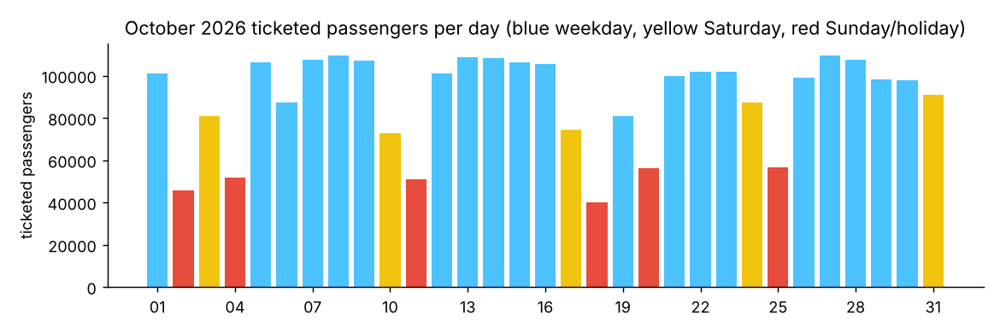
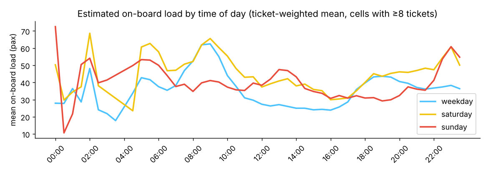
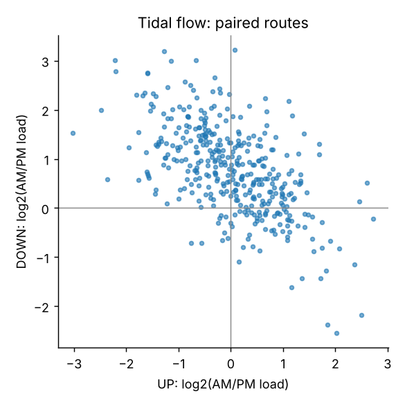
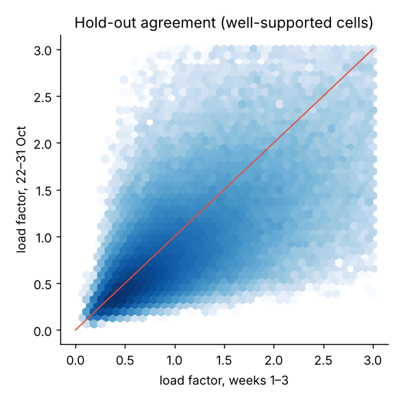

# Validation

Checks of the crowding model against patterns we know to be true, plus a hold-out test.

## 1. Daily ticket volume, weekends and holidays

- Weekday mean **102,303**, Saturday **81,251** (79% of weekday), Sunday **49,872** (49%).
- Gandhi Jayanti (2 Oct) **45,706** (45%) and Dussehra (20 Oct) **56,102** (55%) look like Sundays, which is why the pipeline treats them as such.

## 2. Morning and evening peaks

- Weekday mean load: **58** pax 08:00–10:00, **26** 13:00–15:00, **42** 18:00–20:00 → AM peak is 2.3× midday, PM peak 1.6×.
- Share of well-supported stretches that are *crowded or packed*: **49%** at 08–10h vs **10%** at 13–15h.
- Sunday curve is flat and low; Saturday sits between. The AM peak is sharper than the PM peak, matching Delhi's known commute shape.

## 3. Direction asymmetry on paired routes

For an UP/DOWN pair, the inbound direction should peak in the morning and the outbound in the evening. We compute, for every pair with enough data, the ratio of AM-peak to PM-peak load in each direction.

- 384 route pairs with ≥500 tickets each direction. In **64%** of pairs the two directions peak at opposite ends of the day (points in the top-left / bottom-right quadrants). Strongest examples:

| UP route | AM/PM | DOWN route | AM/PM |
|---|---|---|---|
| 227AUP | 0.21 | 227ADOWN | 8.08 |
| 258UP | 0.22 | 258DOWN | 6.87 |
| D-014UP | 5.66 | D-014DOWN | 0.22 |
| D-018UP | 4.06 | D-018DOWN | 0.17 |
| 307UP | 0.12 | 307DOWN | 2.90 |
| 391UP | 0.18 | 391DOWN | 3.98 |

## 4. Busiest routes

Top routes by ticketed passengers (weekday). These are known heavy corridors (Badarpur–Uttam Nagar, Mehrauli–Anand Vihar, Nehru Place–Dwarka etc.):

| Route | Weekday pax (sampled) |
|---|---|
| 717ADOWN | 986/day |
| 717AUP | 972/day |
| 511AUP | 717/day |
| 729UP | 670/day |
| 729DOWN | 653/day |
| 623UP | 649/day |
| 511ADOWN | 640/day |
| 717BDOWN | 582/day |
| 522UP | 581/day |
| 623DOWN | 580/day |
| 764DOWN | 576/day |
| 764UP | 546/day |

## 5. Hold-out: does the first three weeks predict the last ten days?

Model built on 1–21 Oct (scale S=42.45) vs model built on 22–31 Oct (S=32.88); 232,567 weekday cells well-supported in both.

| Metric | Value |
|---|---|
| Pearson r (log load factor) | **0.78** |
| Spearman ρ | **0.76** |
| Crowding level exact match | **66%** |
| Within one level | **94%** |
| MAE of load factor | 0.31 (route×time mean baseline: 0.31) |

The two scale factors differ by about 25 % (the 22–31 Oct window has only 8 weekdays, so its 95th-percentile cell is noisier); the ranking of stretches is what transfers best. Disagreements concentrate in cells with 8–30 tickets; cells flagged *high* confidence agree best.

Restricting to *high* confidence in both halves (42,931 cells): exact level match **54%**, within one level **94%**, Spearman **0.80**.

## 6. Two independent calibrations agree

- Capacity calibration (95th percentile of well-supported weekday cells = a full bus): **S = 48.11** → implied e-ticket share **2.1%** of riders.
- Ridership calibration (4.1 M weekday bus trips / 102,303 ticketed): **S = 40.08** → **2.5%**.
- The hackathon brief for Problem 3 states e-ticketing is about 3–4 % of all bus tickets. Three numbers from three different sources land in the same range, which is the main evidence that scaling the sample is legitimate.
